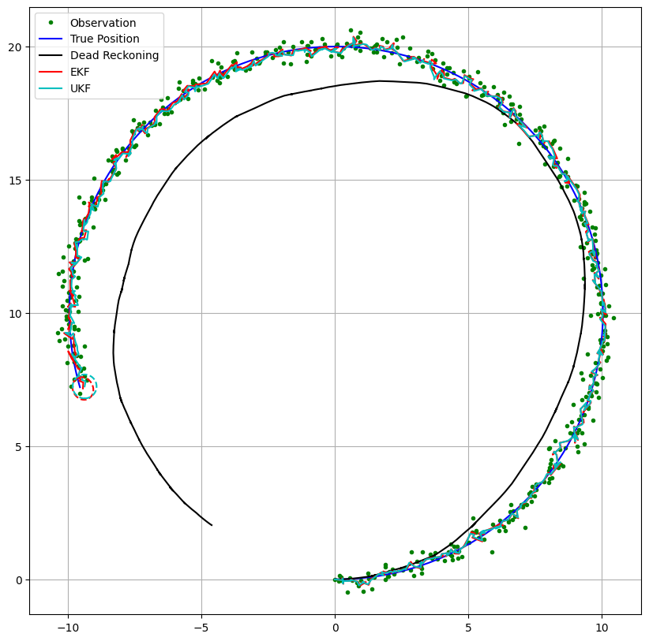

# Project 1: Robot Localization with EKF and UKF

Sensor fusion for the localization of a mobile robot with a nonlinear motion model, using the **Extended Kalman Filter (EKF)** and the **Unscented Kalman Filter (UKF)**, compared against plain **dead reckoning**.



*Blue: true trajectory · Green: GNSS observations · Black: dead reckoning · Red: EKF · Cyan: UKF. The dashed ellipses show the final position covariance of each filter.*

---

## Problem

The robot has three sensors:

| Sensor | Measures | Role |
|---|---|---|
| Speed sensor | linear velocity $v$ | control input |
| Gyroscope | angular velocity $\omega$ | control input |
| GNSS | position $(x, y)$ | observation |

Both the inputs and the observations are corrupted by noise. The aim is to fuse them and estimate the robot's position more accurately than any single source on its own.

### State-space model

State, input and observation vectors:

$$
\mathbf{x}_k = \begin{bmatrix} x_k & y_k & \phi_k & v_k \end{bmatrix}^T, \qquad
\mathbf{u}_k = \begin{bmatrix} v_k & \omega_k \end{bmatrix}^T, \qquad
\mathbf{z}_k = \begin{bmatrix} x_k & y_k \end{bmatrix}^T
$$

Motion model (nonlinear in $\phi$):

$$
\mathbf{x}_{k+1} = A\,\mathbf{x}_k + B(\phi_k)\,\mathbf{u}_k + \mathbf{w}_k,
\qquad
A = \begin{bmatrix} 1&0&0&0\\0&1&0&0\\0&0&1&0\\0&0&0&0 \end{bmatrix},
\quad
B = \begin{bmatrix} \cos\phi\,\Delta t & 0\\ \sin\phi\,\Delta t & 0\\ 0 & \Delta t\\ 1 & 0 \end{bmatrix}
$$

Observation model (linear):

$$
\mathbf{z}_k = C\,\mathbf{x}_k + \mathbf{r}_k,
\qquad
C = \begin{bmatrix} 1&0&0&0\\0&1&0&0 \end{bmatrix}
$$

Jacobians used by the EKF:

$$
J_A = \begin{bmatrix}
1 & 0 & -v\sin\phi\,\Delta t & \cos\phi\,\Delta t\\
0 & 1 & v\cos\phi\,\Delta t & \sin\phi\,\Delta t\\
0 & 0 & 1 & 0\\
0 & 0 & 0 & 1
\end{bmatrix},
\qquad
J_C = C
$$

---

## What is implemented

Every task in the brief ([FIAD2025_Project_I_EN.pdf](FIAD2025_Project_I_EN.pdf)) maps to a function in the notebook:

| # | Task | Implementation |
|---|---|---|
| 1 | Robot dynamic model | `motion_model(x, u, dt)` |
| 2 | Observation model | `observation_model(x)` |
| 3 | Sensor data acquisition | `calc_input()` and `observation(...)`: these add Gaussian noise to the GNSS position and to the velocity and gyro inputs, and also propagate the dead-reckoning estimate |
| 4 | Extended Kalman Filter | `jacobF`, `jacobH`, `ekf_estimation` |
| 5 | Unscented Kalman Filter | `setup_ukf`, `generate_sigma_points`, `predict_sigma_motion`, `predict_sigma_observation`, `calc_sigma_covariance`, `calc_pxz`, `ukf_estimation` |
| 6 | Filter and simulation parameters | Section 6.1 of the notebook (see below) |
| 7 | Simulation and dynamic plot with covariance ellipses | `main(show_animation)` and `plot_covariance_ellipse` |
| 8 | Performance comparison (MAE, RMSE, MAPE, R²) | `calculate_metrics` |
| 9 | Discussion of results | Section 7 (Conclusion) |

Both filters run side by side on the **same** noisy sensor stream, so the comparison between them is fair.

### Parameters

| Parameter | Value | Meaning |
|---|---|---|
| `Q` | `diag(0.3, 0.3, 1°, 1.0)²` | process noise covariance used by the filters |
| `R` | `diag(0.6, 0.6)²` | measurement noise covariance used by the filters |
| `GPS_Noise` | `diag(0.5, 0.5)²` | noise injected into the simulated GNSS readings |
| `Input_Noise` | `diag(1.0 m/s, 30°/s)²` | noise injected into the simulated speed and gyro readings |
| `ALPHA`, `BETA`, `KAPPA` | `0.001`, `2`, `-1` | UKF sigma-point spread, prior on the distribution and secondary scaling ($\kappa = 3 - n$) |
| `dt`, `SIM_TIME` | `0.1 s`, `50 s` | time step and simulation length (500 steps) |
| Input | $v = 1$ m/s, $\omega = 0.1$ rad/s | the robot drives an arc of radius 10 m |

---

## Results

Position error over the whole run (x and y, `np.random.seed(42)`):

| Method | MAE (m) | RMSE (m) | R² |
|---|---:|---:|---:|
| Dead reckoning | 1.98 | 2.75 | 0.83 |
| **EKF** | **0.11** | 0.14 | 1.00 |
| **UKF** | **0.11** | **0.13** | 1.00 |

**Findings**

- **Dead reckoning drifts.** It integrates noisy velocity and gyro readings with no absolute correction, so heading errors accumulate and the trajectory slowly spirals inwards.
- **Both Kalman filters cut the error by about 20×** compared with dead reckoning, because the GNSS observations keep correcting the prediction.
- **EKF and UKF perform almost identically.** The only nonlinearity is the $\cos\phi$ / $\sin\phi$ term, and it is mild at this time step. The observation model is linear. In this setting the first-order linearization of the EKF loses very little, so the extra cost of the UKF buys only a marginal gain (RMSE 0.13 m vs. 0.14 m).
- **MAPE is not meaningful here.** The robot starts at the origin, so the true $x$ and $y$ values are at or near zero for part of the run. Dividing by them makes MAPE blow up for both filters. It is reported in the notebook for completeness but left out of the comparison.

---

## Running it

Requirements: Python 3.8+ and

```bash
pip install numpy scipy matplotlib scikit-learn jupyter
```

Then open the notebook and run all cells:

```bash
jupyter notebook FIAD_Rodrigues_Pacheco_2024.ipynb
```

The last cell calls `main(True)`, which animates the trajectories and covariance ellipses step by step and then prints the metrics. Redrawing the figure 500 times is slow. Change it to `main(False)` to draw only the final plot.

---

## Files

```
Project1/
├── FIAD_Rodrigues_Pacheco_2024.ipynb   # main deliverable: code and report
├── FIAD2025_Project_I_EN.pdf           # project brief
├── FIAD2025_EKF_struct_Python.ipynb    # EKF skeleton provided by the course
├── FIAD2025_UKF_struct_Python.ipynb    # UKF skeleton provided by the course
└── images/
    └── trajectory.png                  # result figure used in this README
```

---

## Limitations and possible extensions

- The results come from a single simulated run with one seed. A Monte Carlo study over many seeds would show whether the small UKF advantage is consistent.
- The UKF computes the cross-covariance $P_{xz}$ from the propagated state sigma points but takes the measurement sigma points from a resampled set. Using the same sigma set for both is the textbook formulation.
- With $\alpha = 0.001$ and $\kappa = -1$, the sigma-point weights become very large in magnitude, which is numerically fragile. A Cholesky factorization instead of `sqrtm` and $\alpha \approx 0.1$–$1$ would be more robust.
- Possible next steps: a more strongly nonlinear scenario (sharper turns, range-bearing observations) where EKF and UKF actually differ, NEES/NIS consistency checks, and a comparison of run times.

---

## Acknowledgements

The model formulation and the code skeletons were provided by the FIAD teaching staff (Alberto Cardoso and Jorge Henriques, DEI-UC). The code follows the structure of the EKF and UKF localization examples in [PythonRobotics](https://github.com/AtsushiSakai/PythonRobotics).
