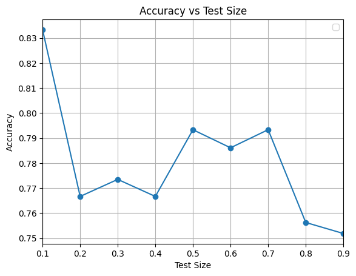

# Project 2: Bayesian Fusion Model for Life Insurance Decisions

A **Naive Bayes decision model, implemented from scratch**, that fuses demographic, health and financial information with an insurance company's rule-based recommendation. It predicts whether a person will buy life insurance.

The brief did not allow Bayesian libraries, so the priors, the conditional probability tables and the posterior are all computed by hand. pandas is used only for loading data and scikit-learn only for the train/test split.

---

## Problem

Each individual is described by seven variables. Their decision $T \in \{0, 1\}$ (0 = did not buy, 1 = bought) is known and is treated as correct. The model has to fuse four groups of evidence:

| Source | Variables |
|---|---|
| $z_1$ Personal | Gender, Age, Marital status, Number of children/dependents |
| $z_2$ Health | Physical status, Chronic disease |
| $z_3$ Financial | Monthly salary |
| $z_4$ Expert rule | Insurance company's suggestion (computed from a points system) |

### Dataset: [lifeInsurance.csv](lifeInsurance.csv)

600 individuals, no missing values. The same data is also provided as [lifeInsurance.txt](lifeInsurance.txt), space-separated.

| Variable | Values |
|---|---|
| Gender | 0 = female, 1 = male |
| Age | 34 – 101 years |
| MaritalStatus | 0 = single, 1 = married |
| NumberOfChildren | 0, 1, 2, ≥3 |
| PhysicalStatus | 0 = sedentary, 1 = moderately active, 2 = active |
| ChronicDisease | 0 = none, 1 = moderate, 2 = severe |
| MonthlySalary | 1370 – 3800 € |
| **Decision** (target) | 0 = not purchase (68%), 1 = purchase (32%) |

---

## Method

### 1. Insurance company suggestion (expert rule)

A new binary feature, `Suggestion`, is added. It is 1 when an individual's risk score is above 50 points. The score adds points for age, health (chronic disease), income and number of dependents, following the scale in the brief ([Meta2_lifeInsurance_1.pdf](Meta2_lifeInsurance_1.pdf), slide 4).

### 2. Discretization

The model uses frequency counts, so the two continuous variables are binned into categories with a clear meaning. Equal-frequency binning is not used.

| Age | Label | | Monthly salary | Label |
|---|---|---|---|---|
| < 30 | 0: Young adult | | < 1500 € | 0: Low income |
| 30 – 39 | 1: Adult | | 1500 – 2999 € | 1: Mid income |
| 40 – 49 | 2: Mature adult | | ≥ 3000 € | 2: High income |
| 50 – 59 | 3: Middle aged | | | |
| ≥ 60 | 4: Senior | | | |

### 3. Naive Bayes model (`BayesianModel` class)

The model assumes the features are independent given the class:

$$
P(T = t \mid \mathbf{x}) \;\propto\; P(T = t)\prod_{i=1}^{8} P(X_i = x_i \mid T = t)
$$

| Method | Role |
|---|---|
| `priori_cal(y)` | class priors $P(T=t)$ from class frequencies |
| `calculate_condition(...)` | conditional table $P(X_i = x \mid T = t)$ for one feature, with Laplace smoothing when a category is missing from the training set |
| `train(X, y)` | builds the priors and the conditional tables for all 8 features |
| `calculate_likelihood(x)` | multiplies the conditional probabilities for one sample |
| `predict(x)` | normalises the two scores and returns class 1 if its posterior ≥ 0.5 |
| `print_probabilities()` | prints the learned tables |

---

## Results

With a 90 / 10 train/test split (`random_state=42`), the model reaches **83.3% accuracy** on the 60 held-out samples. Always predicting "not purchase" would score 68%.

The notebook repeats the experiment with test sizes from 10% to 90%:



Accuracy stays between **75% and 83%**. Even with only 60 training samples (test size 0.9), the model still reaches about 75%.

### Answers to the questions in the brief

| Question | Answer |
|---|---|
| Is the classifier's performance acceptable? | Yes. Accuracy is 75–83%, against a 68% majority-class baseline. |
| Should all variables be used? | Not necessarily. Age, NumberOfChildren, ChronicDisease and MonthlySalary have clearly different conditional distributions in the two classes. Gender and Suggestion barely differ, so they add little information. |
| Discrete or continuous variables? | All variables were discretized. The likelihoods then come directly from frequency counts, with no distributional assumption, and the model stays easy to interpret. |
| Normal conditional probabilities? | No. The conditional probabilities are non-parametric (counted frequencies), so no normality assumption is needed. |
| Other distributions or Gaussian mixtures? | Not explored. A Gaussian Naive Bayes or a Gaussian mixture model on raw Age and Salary is the natural next step, to avoid the information lost through binning. |

---

## Running it

```bash
pip install numpy pandas matplotlib scikit-learn jupyter
jupyter notebook FIAD_Project_2.ipynb
```

---

## Files

```
Project2/
├── FIAD_Project_2.ipynb          # implementation
├── FIAD_Rodrigues_Pacheco.pdf    # report (Portuguese)
├── Meta2_lifeInsurance_1.pdf     # project brief
├── lifeInsurance.csv             # dataset (; separated, with header)
├── lifeInsurance.txt             # same dataset, original format
└── images/
    └── accuracy_vs_test_size.png
```

---

## Known issues and future work

- **The prior is not used in `predict`.** `calculate_likelihood` multiplies only the conditional probabilities, so the decision is maximum-likelihood rather than maximum a posteriori. Multiplying by `self.prior_prob` would match the equation above.
- **The health points in the suggestion rule are inverted.** The brief gives 5 points for healthy and 15 for serious conditions, but the code gives the opposite. This may explain why `Suggestion` turns out to be uninformative.
- **Age binning skips the boundaries.** The conditions `30 <= age < 39`, `40 <= age < 49` and `50 <= age < 59` send ages 39, 49 and 59 to the "Senior" bin. They should be `< 40`, `< 50` and `< 60`.
- **Laplace smoothing is applied inconsistently.** The class denominators grow inside the category loop, so a smoothed table no longer sums to 1. Adding $+1$ to every count and $+K$ to each class total once would fix this.
- **The evaluation uses a single random split.** Stratified k-fold cross-validation, together with precision, recall and F1 for the minority "purchase" class, would give a more reliable estimate.
- Feature selection, and Gaussian or GMM likelihoods for the continuous variables, are possible extensions.
